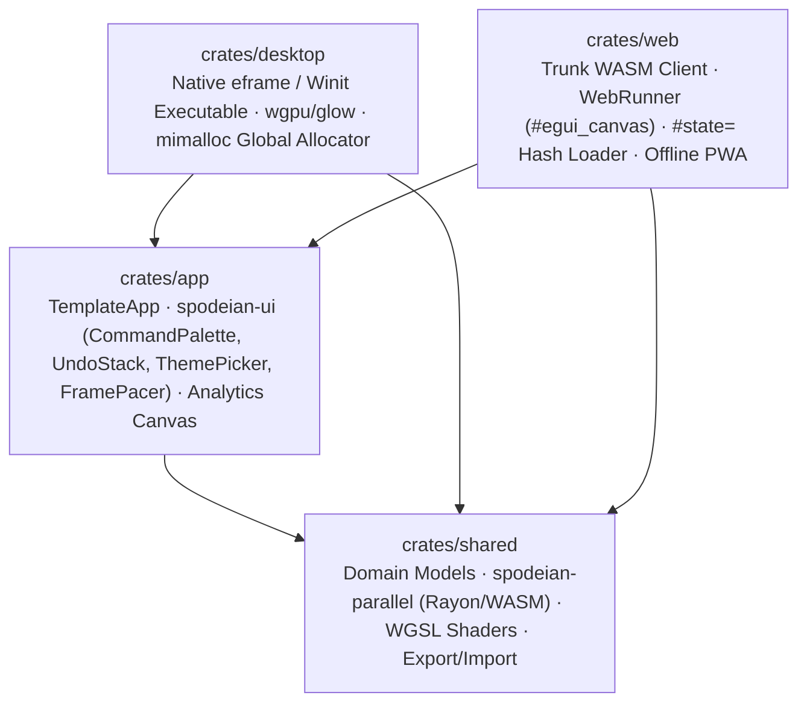

# Architecture Guide · `efficient-egui-template`

This template targets **high-frequency interactive GUIs, 2D/3D visualizations, audio/CAD/science workbenches, and single-binary native + WASM applications** built on **`egui 0.36` / `eframe 0.36`**.

---

## 1. Four-Crate Immediate-Mode Workspace

| Crate | Features | Responsibility |
|---|---|---|
| `crates/shared` | `std` | Pure Rust domain entities (`Item`, `ItemCollection`, `AppState`, `AccessibilityPreferences`), `ParametricPreviewConfig`, `spodeian-parallel` sweeps, bundled `PARAMETRIC_HARMONIC_WGSL_SHADER`, and JSON/CSV/BSON/SVG/HTML/`#state=` interchange. |
| `crates/app` | `accesskit`, `persistence`, `wgpu` *(or `glow`)* | Immediate-mode UI (`TemplateApp`), `spodeian-ui` shell widgets (`CommandPaletteWidget`, `UndoStack`, `LogConsoleWidget`, `ReactiveFramePacer`), interactive 2D pan/zoom canvas, Zen Mode (`F11`), and `StorageManager`. |
| `crates/desktop` | `accesskit`, `persistence`, `wgpu` *(or `glow`)* | Native desktop executable (`winit` viewport min `320x240`, `mimalloc` allocator, `tracing` console/file diagnostics). |
| `crates/web` | `accesskit`, `persistence`, `wgpu` *(or `glow`)* | WebAssembly entrypoint booting `eframe::WebRunner` on `#egui_canvas`, hydrating `#state=` URL hashes on launch, and registering offline PWA (`sw.js`) & strict CSP `_headers`. |

---

## 2. Graphics Backends (`wgpu` vs. `glow`) & WGSL Compute

- **Default (`wgpu`)**: Compiles `eframe/wgpu` targeting **Vulkan / Metal / DirectX 12** natively and **WebGPU** (with automatic fallback inside `eframe`) on modern browsers.
- **Compatibility (`--no-default-features --features accesskit,persistence,glow`)**: Targets OpenGL / WebGL2 for older VMs or environments lacking WebGPU drivers. Call `app::active_renderer_label()` to inspect the compiled backend.
- **Compute Shader Alignment**: `shared::PARAMETRIC_HARMONIC_WGSL_SHADER` provides a standalone `@compute @workgroup_size(64)` WGSL kernel matching `ParametricPreviewConfig::evaluate_harmonic_wgsl_cpu_reference()` for GPU-accelerated compute integration via `sml_kernel`.

---

## 3. Parallel Compute (`spodeian-parallel`: `rayon` + `wasm32` SIMD128)

- On native desktops, `ParametricPreviewConfig::sample_points` and `batch_harmonic_sweep` execute multi-threaded over **Rayon** (`spodeian-parallel`).
- On `wasm32-unknown-unknown`, `spodeian-parallel` compiles cleanly to single-threaded sequential loops vectorized by `.cargo/config.toml` `+simd128` flags without requiring `SharedArrayBuffer` COOP/COEP headers.

---

## 4. Frame Pacing, Persistence & Safe State Sharing

- **Battery & Browser Frame Pacing (`ReactiveFramePacer`)**: Suppresses busy-loop repaints when idle and boosts cadence smoothly during hover/drag animations or modal transitions.
- **Multi-Tier Storage & Backup**: `StorageManager` routes hot working sets (`MEMORY_WORKING_SET_LIMIT = 100`) to `localStorage` (< 16 KB) / IndexedDB on web and atomic JSON snapshots on desktop, while preserving schema evolution (`schema_version` + `StateMigrator`).
- **Non-Destructive `#state=` URL Sharing**: Opening a `#state=` URL snapshots the user's pre-existing local workspace before rendering the shared preview banner (`Keep Shared Copy` vs. `Restore My Local Data`).
