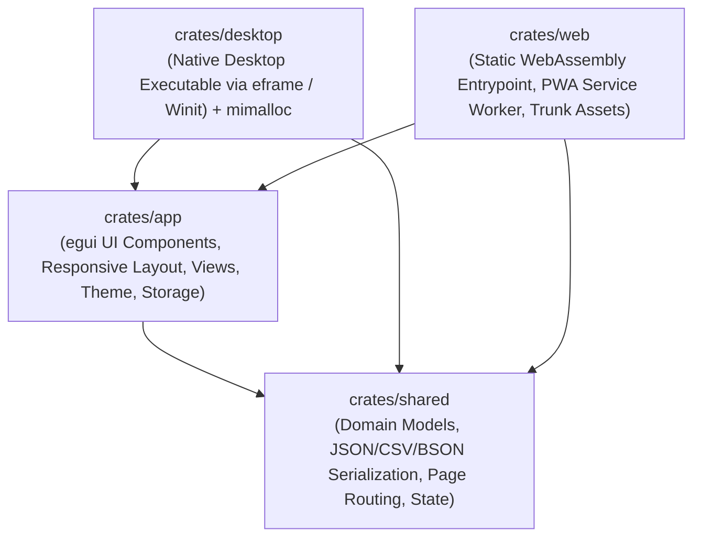

# Serverless & Desktop egui Template

[](https://github.com/Spodeian/efficient-egui-template/actions/workflows/ci.yml)
[](https://github.com/Spodeian/efficient-egui-template/actions/workflows/static.yml)
[](LICENSE.md)
[](https://www.rust-lang.org)
[](https://github.com/emilk/egui)
[](https://pages.cloudflare.com)

A production-ready, modular Rust & [`egui 0.36`](https://github.com/emilk/egui) / [`eframe 0.36`](https://docs.rs/eframe) template designed for high-performance **Serverless Web (WASM / Cloudflare Pages / PWA via Trunk)** and **Native Desktop (Windows, macOS, Linux via Winit)** applications.

Featuring a complete example application with a **collapsible top bar** and **Zen Mode**, **persistent multi-page routing** (`Dashboard`, `Analytics`, and `About` views), **`spodeian-parallel` (Rayon + WASM) & WebGPU WGSL compute readiness**, **interactive data management & SVG/HTML/share-link interchange**, and a **status footer**. See [`ARCHITECTURE.md`](ARCHITECTURE.md) for deep technical details.

---

## 🚀 Using this Template

### Option A: `cargo-generate` (Recommended)

Scaffold a new application directly with optional desktop, PWA, Cloudflare Pages, and Android/iOS module prompts (`cargo-generate.toml`):

```bash
cargo install cargo-generate
cargo generate --git https://github.com/Spodeian/efficient-egui-template --name my-app
cd my-app
```

Available `cargo-generate.toml` template flags (all default to `true`):
- `include_desktop`: Native desktop runner crate (`crates/desktop`)
- `include_pwa`: Progressive Web App manifest (`manifest.json`), service worker (`sw.js`), and offline registration
- `include_cloudflare_pages`: Cloudflare Pages security headers (`_headers`) and routing configuration
- `include_mobile_entrypoints`: Android (`mobile-android`) and iOS (`mobile-ios`) FFI / library scaffolds

> **License notice:** Generated projects inherit the template's PolyForm Noncommercial 1.0.0 (`LICENSE`) terms unless a separate commercial license is granted.

### Option B: GitHub Template

1. Click **"Use this template"** > **"Create a new repository"** on GitHub.
2. Clone your new repository locally:
   ```bash
   git clone https://github.com/your-username/your-app-name.git
   cd your-app-name
   ```
3. Follow the [Customizing for Your App](#-customizing-for-your-app) guide below to personalize the project name and metadata.

---

## 🏛️ Architectural Structure

The workspace is organized into four decoupled, single-responsibility crates:



- **[`crates/shared`](crates/shared)**: Core domain models, business logic, configuration (`ThemeMode`, `AppConfig`, `AppPage`, `AppState`), and interchange serialization (JSON, CSV, and compressed BSON import/export).
- **[`crates/app`](crates/app)**: Modular UI view controller and layout layer powered by `egui` & `eframe`. Contains responsive design helpers (`ScreenConstraints`), the light/dark theme engine, view components (`navbar`, `item_list`, `about`, `modals`), and persistent multi-tiered state management.
- **[`crates/desktop`](crates/desktop)**: Native runner configured with `tracing` logging and native window viewport settings.
- **[`crates/web`](crates/web)**: WebAssembly client entrypoint with `wasm-bindgen`, WebRunner initialization, local PWA assets (`icon-192.png`, `icon-512.png`, `manifest.json`), Service Worker, and edge headers.

---

## ✨ Key Features

- **⚡ Dual-Target Desktop & Serverless Web**: Compile identical UI logic to desktop native executables (Windows, macOS, Linux) or static client-side WASM bundles for Cloudflare Pages and GitHub Pages.
- **🧭 Multi-Page Layout & Focus Modes**:
  - **Collapsible Navigation Bar**: Global branding, view switcher (`Dashboard`, `Analytics`, & `About`), visual theme picker, `Tools` overflow menu (Undo/Redo, Export/Import, Telemetry/Logs, Storage, Zen Mode), and inline status toasts.
  - **Dashboard Page**: Interactive item collection with real-time statistics, search & priority filtering, instant creation, and drag-and-drop `.json` / `.csv` / `.bson` file import.
  - **Analytics Page**: KPI `PerformanceMetricCard`s, colorblind-safe priority breakdown chart, and interactive 2D pan/zoom parametric signal explorer (`ParametricPreviewConfig`) with `.svg` and printable `.html` exports.
  - **About Page**: Architectural overview, embedded `ThemePickerWidget` & `AccessibilityPreferences` panel (`ColorblindMode`, reduced motion, large touch targets, UI scaling, dyslexia-friendly spacing), live runtime diagnostics, and keyboard shortcuts guide (`F11` Zen Mode, `Ctrl+K` Command Palette, `Ctrl+Shift+L` Share Link).
  - **Shared-Link Banner & Bottom Status Footer**: Non-destructive preview/restore banner for `#state=` shared URLs, live storage tier indicator (`LocalStorage` vs `IndexedDB`), quick page navigation links, and licensing notice.
- **💾 Robust Multi-Tier State Persistence & Memory Protection**:
  - **In-Memory Tier (RAM)**: Native Rust struct representation for sub-microsecond latency, 0-allocation query paths, and 60-120 FPS rendering. Includes bounded capacity (`MEMORY_WORKING_SET_LIMIT` = 100 items) to prevent browser tab and process memory exhaustion (OOM).
  - **Tier 1 (Fast Sync)**: Synchronous browser `localStorage` under dedicated storage key `serverless_template_app_state` for fast reloads (< 16 KB).
  - **Tier 2 (IndexedDB Fallback)**: Structured, transactional `IndexedDB` backing store that receives synchronized copies of state and acts as a durable fallback to prevent memory from overfilling on large datasets.
  - **Dual-Format Deserializer**: Attempts JSON deserialization first, seamlessly falling back to RON for backwards and forwards compatibility.
  - **Active State Persistence**: Dispatches immediate saves on user interactions (adds, toggles, deletions, resets, imports, theme changes) in addition to window close / `beforeunload` events.
  - **Storage Diagnostics Modal**: Live inspection of memory item count, capacity limits, active storage tier, and persistence status (persistent vs. ephemeral) with one-click permission requests (`StorageManager.persist()`).
- **📱 Responsive & Touch-Friendly UI**: Layout automatically adapts across widescreen desktop monitors, tablets, and constrained mobile portrait viewports with adaptive element sizing and soft-wrap line calculations.
- **🎨 Theme & Accessibility Engine**: Instant toggle via `ThemePickerWidget` between Charcoal Dark, Warm Light, High Contrast Dark, and High Contrast Light modes alongside `AccessibilityPreferences` (`ColorblindMode`, reduced motion, large touch targets, dyslexia-friendly spacing, `80%`–`150%` scaling) and `ReactiveFramePacer`.
- **⌨️ Intuitive Keyboard Support**: Press `Enter` to submit items, `Ctrl+K` for Command Palette, `Ctrl+Z` / `Ctrl+Y` for Undo/Redo, `F11` for Zen Mode, `Ctrl+Shift+L` to copy a shareable `#state=` link, and `Escape` to close modals.
- **📦 Data Interchange, Drag-and-Drop & File Downloads**:
  - Export and import formatted **JSON**, RFC 4180-compliant **CSV**, compact **Compressed BSON** (Zlib-compressed binary), self-contained **SVG** charts, printable **HTML** reports, and compressed `#state=<base64url>` shareable URL hashes.
  - Built-in drag-and-drop file import (`.json`, `.csv`, `.bson`), clipboard feedback toast, and direct browser file download triggers (`trigger_text_download`, `trigger_binary_download`).
- **📶 Offline Progressive Web App (PWA)**:
  - Bundled local offline icons (192x192 and 512x512 maskable PNGs) meeting Lighthouse PWA installability requirements.
  - Hybrid service worker caching strategy (**Network-First** for `index.html` to guarantee atomic releases; **Cache-First** for immutable, content-hashed `.wasm`, `.js`, and `.css` assets) with offline fallback.
- **🛡️ SRI Minification Immunity**: Configured with `data-integrity="none"` in `index.html` to allow aggressive post-build asset minification (HTML, CSS, JS) without SRI hash mismatches or white screens.
- **🚀 Automated CI/CD & Deployment Pipelines**: Pre-configured for Cloudflare Pages Build System v3 (`deploy.sh`), GitHub Pages (`.github/workflows/static.yml`), and full CI test suite with WASM browser tests (`.github/workflows/ci.yml`).

---

## 🛠️ Build Requirements

- **Rust Toolchain**: Automatically managed via [`rust-toolchain.toml`](rust-toolchain.toml) (installs stable with `wasm32-unknown-unknown`).
- **Trunk Bundler**:
  ```bash
  cargo install trunk
  ```
- **Node.js 24 LTS**: (Required for asset minification pipelines, Wrangler edge previews, and Cloudflare Pages compatibility; managed via [`.node-version`](.node-version) / [`.nvmrc`](.nvmrc)):
  ```bash
  nvm use # or fnm use
  ```
- *(Optional)* **wasm-opt** (Binaryen v132+) for release binary size optimization.

---

## 🚀 Development Quickstart

### 1. Run Web App Locally (Trunk)
```bash
trunk serve
```
Open [http://localhost:8080](http://localhost:8080) in your browser. Live reloading is automatically enabled.

### 2. Run Native Desktop App
```bash
cargo run -p desktop
```

### 3. Run Test Suite
```bash
# Run all workspace tests (shared, app, web, desktop)
cargo test --workspace

# Or with cargo-nextest (faster, parallel execution)
cargo nextest run --workspace
```

### 4. Run WebAssembly Browser Tests
```bash
cargo test -p web --test wasm_tests --target wasm32-unknown-unknown
```

### 5. Run Static Analysis & Linter
```bash
cargo clippy --workspace --all-targets --all-features -- -D warnings
```

---

## 📦 Production Builds & Deployment

### Static Serverless WASM Bundle (Trunk)
```bash
trunk build --release
```
The optimized output assets (`index.html`, `.wasm`, `.js`, `.css`, `_headers`, `manifest.json`, `sw.js`) will be located in `crates/web/dist/`.

### Cloudflare Pages (Build System v3)

Deploy directly to Cloudflare Pages using the automated build script:

```bash
bash deploy.sh
```

#### Cloudflare Pages Dashboard Settings:
- **Build System Version**: `v3` (2024/2026 build image)
- **Framework Preset**: `None` (or `Custom`)
- **Build Command**: `bash deploy.sh`
- **Build Output Directory**: `crates/web/dist`
- **Environment Variables**:
  - `NODE_VERSION`: `24`
  - `RUST_VERSION`: `stable` (Optional if `rust-toolchain.toml` is present)
  - `CARGO_HOME`: `/opt/buildhome/.cargo`

#### Local Preview with Wrangler:
```bash
trunk build --release
npx wrangler pages dev crates/web/dist
```

### GitHub Pages Deployment

The repository includes a ready-to-use GitHub Actions workflow in [`.github/workflows/static.yml`](.github/workflows/static.yml) that builds, minifies, and deploys your WASM web application to GitHub Pages whenever changes are pushed to `main`.

### Native Desktop Binary
```bash
cargo build -p desktop --release
```
The compiled release executable will be located in `target/release/`.

---

## 🧩 Customizing for Your App

1. **Rename Workspace & Metadata**: Update `name`, `version`, `authors`, and `repository` in [`Cargo.toml`](Cargo.toml) and subcrate manifests.
2. **Define Domain Data**: Replace `Item` and `ItemCollection` in [`crates/shared/src/models.rs`](crates/shared/src/models.rs) with your application's domain models.
3. **Build Views & Components**: Add or update UI views in [`crates/app/src/components/`](crates/app/src/components/):
   - [`components/navbar.rs`](crates/app/src/components/navbar.rs): Collapsible header bar, navigation tabs, `Tools` overflow menu, and inline status toast.
   - [`components/item_list.rs`](crates/app/src/components/item_list.rs): Main content layout, input forms, and data cards.
   - [`components/analytics.rs`](crates/app/src/components/analytics.rs): KPI metrics, priority breakdown chart, and interactive 2D pan/zoom parametric signal explorer.
   - [`components/about.rs`](crates/app/src/components/about.rs): About page, `ThemePickerWidget`, `AccessibilityPreferences` controls, architecture details, and shortcuts.
   - [`components/modals.rs`](crates/app/src/components/modals.rs): Dialogs, multi-format import/export dialogs, and storage panels.
   - [`components/telemetry_viewer.rs`](crates/app/src/components/telemetry_viewer.rs): Telemetry KPIs and embedded `LogConsoleWidget`.
4. **Update PWA & SEO Tags**: Customize `title`, meta description, OpenGraph tags, and icons in [`crates/web/index.html`](crates/web/index.html) and [`crates/web/manifest.json`](crates/web/manifest.json).

---

## ⚖️ Spodeian Template Family & Starter Comparison

### Choosing Across the Three Spodeian Templates

| Template | Best For | Architecture | Compute, GPU & Native Target |
|---|---|---|---|
| **`efficient-egui-template`** *(this repo)* | Custom 2D/3D viewports, CAD/science/audio GUIs, single-binary apps | 4 crates (`shared`, `app`, `desktop`, `web`) + `spodeian-ui` | `wgpu` (default) / `glow`, native `winit` + `mimalloc`, `spodeian-parallel` (Rayon/WASM), WGSL shader ready |
| **`efficient-leptos-template`** | Hybrid websites + native desktop/mobile apps sharing one DOM UI | 5 crates (`shared`, `app`, `web`, `ssg`, `desktop`) | Static SSR + WASM `hydrate` + Tauri v2 `csr` + native Rayon IPC commands + WGSL shader ready |
| **`efficient-leptos-edge-template`** | Pure zero-backend edge websites, SEO content, PWAs | 4 crates (`shared`, `app`, `web`, `ssg`) — zero desktop deps | Static SSR + WASM `hydrate` only, JSON-LD, `sitemap.xml`, `_redirects`, Rayon SSR / SIMD128 WASM |

### vs. Generic `eframe` Starters

| Capability | `efficient-egui-template` | `emilk/eframe_template` | Bare `eframe` App |
|---|---|---|---|
| **Crate Architecture** | Modular 4-crate workspace (`shared`, `app`, `desktop`, `web`) + `spodeian-core` v3.0 primitives | Single crate (`src/lib.rs`, `src/app.rs`, `src/main.rs`) | Single binary crate |
| **Compute & Rendering (`rayon` / `wgpu`)** | `spodeian-parallel` (Rayon desktop / SIMD128 WASM), `wgpu` (default) + `glow` fallback (`active_renderer_label()`), bundled WGSL shader | Basic `eframe` loop | Manual implementation |
| **Command Palette & Undo/Redo** | Built-in `CommandPaletteWidget`, shortcut conflict detector (`detect_shortcut_conflicts`), & `UndoStack` (`spodeian-ui`) | Manual implementation | Manual implementation |
| **Persistence & Migration** | Versioned `AppState` envelopes (`schema_version`), JSON/Compressed BSON/CSV (`spodeian-export`), multi-tier fallback (`spodeian-persist`) | Basic `eframe::get_value` / `set_value` | Manual implementation |
| **PWA & Cloudflare Pages** | Included `manifest.json`, cache-versioned `sw.js` (`spodeian-web-utils`), `_headers` | Minimal service worker | None |
| **Accessibility & Recovery** | Dark / Light / High-Contrast themes (`spodeian-tokens`), dyslexia-friendly mode, recoverable error/panic boundary | Default egui style | Default egui style |
| **Testing & Scaffolding** | 34 host unit/integration/`proptest` suites + Criterion benches + runnable examples + `cargo-generate.toml` + `wasm32` browser tests | Minimal starter tests | None |

---

## 🔄 Upgrading from 0.1.x

When rebasing an existing project onto `0.2.0` (see [`CHANGELOG.md`](./CHANGELOG.md)):

1. **Workspace `spodeian-core` Dependencies:** Shared UI, persistence, export, telemetry, tokens, and web helpers now resolve through `spodeian-core` (`spodeian-ui`, `spodeian-persist`, `spodeian-export`, `spodeian-telemetry`, `spodeian-tokens`, `spodeian-web-utils`).
2. **Versioned State & Migration (`shared::AppState`):** `AppState` now tracks `schema_version` (`CURRENT_SCHEMA_VERSION`) and automatically upgrades legacy 0.1.x snapshots when loaded from storage, JSON, or compressed BSON.
3. **Command Palette & Shortcuts (`app`):** Action navigation, theme cycling, accessibility toggles, and data exports are registered via `default_template_commands()` and `CommandPaletteWidget`, backed by `UndoStack` and `detect_shortcut_conflicts()`.
4. **Recoverable Panic/Error Overlay:** `TemplateApp` surfaces storage quota/fallback warnings and recoverable runtime errors in-UI instead of crashing silently.

---

## 🧪 Testing & Quality Assurance

Verified host test baseline (`cargo test --workspace`): **34 passed, 0 failed** (`app`: 14 including 3 `proptest` suites, `shared`: 18 including 4 `proptest` suites + `spodeian-parallel`/WGSL parity, `desktop`: 1, `web`: 1 host smoke test; `wasm_tests.rs` targets `wasm32` browsers; `cargo run -p shared --example state_interchange_and_report`, `cargo check -p shared --benches`, `RUSTDOCFLAGS="-D warnings" cargo doc`, and native + `wasm32` `clippy -D warnings` verified).

| Test Suite | Location | Verified Host Tests | Purpose |
|---|---|---|---|
| **App Tests** | `crates/app/tests/app_tests.rs` | 14 passed | UI initialization, command palette & undo/redo `proptest` invariants, Zen Mode & shared-link hash restore, dropped file import, SVG/HTML/share exports, shortcut conflict detection, panic recovery |
| **Shared Model Tests** | `crates/shared/tests/shared_tests.rs` | 18 passed | Collection logic, Analytics routing, `spodeian-parallel` sweeps & WGSL parity, SVG/HTML/shareable `#state=` exports, JSON/CSV/BSON roundtrips, `schema_version` migration, `proptest` invariants |
| **Desktop Smoke** | `crates/desktop/tests/smoke_tests.rs` | 1 passed | Desktop native options and viewport validation |
| **Web Smoke** | `crates/web/tests/smoke_tests.rs` | 1 passed | WebRunner app construction and wasm compatibility |
| **WASM Browser Tests** | `crates/web/tests/wasm_tests.rs` | `wasm32` target | Headless Chrome/Firefox DOM and localStorage persistence tests |
| **Benchmarks** | `crates/shared/benches/serialization_benchmarks.rs` | Compiles (`--benches`) | Criterion benchmarks for state serialization performance |

---

## 📄 License

Licensed under the [PolyForm Noncommercial License 1.0.0](LICENSE.md). You may use,
change and share this software for any noncommercial purpose. For a
commercial license, contact [Spodeian](https://github.com/Spodeian). Earlier
releases keep the license they were published under.

Projects generated from this template inherit the PolyForm Noncommercial
License unless Spodeian grants otherwise.
